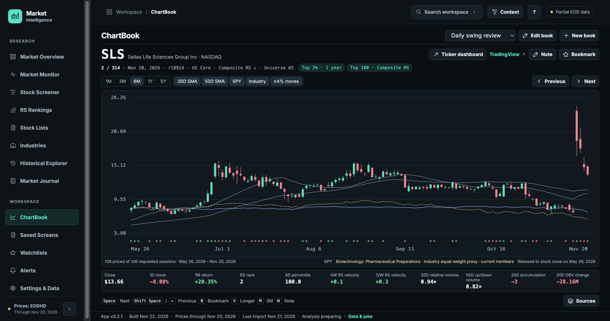
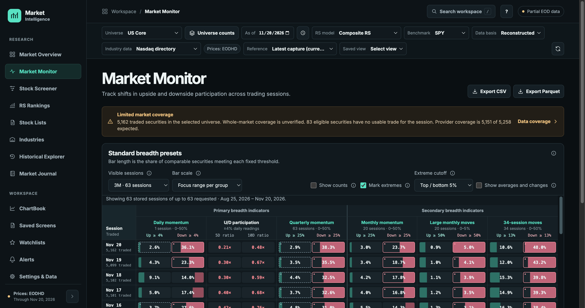
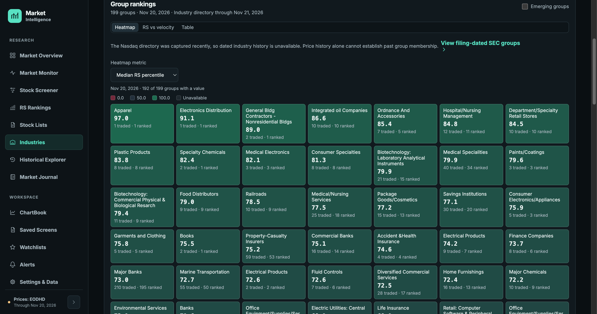

# Market Intelligence


A local, data-versioned research workspace for U.S. stock leadership, relative strength, market breadth, and industry participation. It helps a researcher move from the market's condition to the groups and securities driving it, then preserve the screen or thesis for later review. It is decision support, not automated trading.

## Current status

Immutable R12 / app 0.2.2 is live with calculation `2-be44dec1f429`; check `/api/v1/build` and `data/active-release.json` for the active build. Bounded verification of the previously saved five-year `2-081` output is in progress; it remains unpublished, and the ten-minute target is not met. See [Remaining work](docs/REMAINING-WORK.md) and [Performance acceptance](docs/PERFORMANCE-ACCEPTANCE.md) for current readiness and validation status.

## From market context to a saved review


1. **Read participation.** Market Overview compares index context with breadth counts, percentages, leadership, and market-health components. Market Monitor provides fixed and custom move thresholds with date-specific constituent drilldowns.
2. **Find leaders and changing groups.** Independent return leader lists answer which securities led a period. Model-based RS rankings answer which names rank strongly under the selected model. Industry and theme views compare participation, relative performance, and leadership using the classification and date shown.
3. **Screen and inspect.** Use nested filters, supported expressions, high/low and volume measures, and history-aware fields. Ticker detail shows available prices, moving averages, volume, relative strength, source status, and null reasons.
4. **Keep a dated review.** Save reusable rules in Saved Screens, carry selections into watchlists or ChartBook, and attach a private dated note in Market Journal. Historical replay pins the requested date and data revision where available.







The [research workflow diagram](docs/assets/research-workflow.jpg) and [data-flow diagram](docs/assets/data-pipeline.jpg) are conceptual illustrations, not screenshots or measured performance charts. Asset provenance and alt text are documented in [README assets](docs/README-ASSETS.md).

## What the workspace includes

- **Market Overview and Monitor:** breadth by comparable population, daily and multi-session movement, moving-average participation, advances/declines, volume measures, and exact qualifying/excluded constituents.
- **Relative strength and Stock Lists:** independent 1W/1M/3M/6M/1Y return leaders, configurable top-percent cuts, model rankings, velocity, persistence, and leadership changes. Rank is a position within the selected comparable population; velocity is a change in percentile points over time. They answer different questions.
- **Screener and ticker detail:** nested conditions, multi-sort, computed columns, saved definitions, context-aware high/low filters, price/volume analytics, risk measures, and source-quality details. Missing float and unsupported history remain blank or withheld.
- **Industry, themes, and historical research:** group comparisons, rotation, breadth, replay, cohorts, event studies, analogs, transitions, and forward-return distributions with sample and availability context.
- **ChartBook and Market Journal:** combine saved lists into a deduplicated chart review; preserve notes by security and date; optionally use a configured Claude key for Journal generation. When the user requests generation, selected market context is sent to Anthropic; private notes are included only after a separate opt-in. No live Claude generation has been verified here because no key has been supplied.
- **Local operations:** resumable background jobs, data-quality and readiness views, source-correction provenance, SQLite backups, and optional CSV/Parquet exports.

Calculations use a shared engine and pinned data, context, and calculation versions. Changing the universe, model, benchmark, classification, date, or price basis may change the eligible population or result. Check readiness for the exact requested context before interpreting a chart or list.

## Quick start

Requirements: Node.js 26 LTS is recommended and tested for the current workspace. The package supports Node.js `^24.15.0 || >=26.0.0`. A managed macOS service can keep the local preview running; a foreground server is suitable for a fresh checkout.

```sh
git clone git@github.com:joshuamschultz/market-intelligence.git
cd market-intelligence
npm ci
npm run app -- start --workspace
```

The command starts the source workspace and opens the browser; it refuses to replace an active immutable release. For a foreground server, first stop the managed service with `npm run app -- stop`, then run `npm start` or `npm run dev`. Do not run two processes against the same `MARKET_DB`; they can interfere with background jobs. To use authenticated provider capture on a fresh setup, copy `.env.example` to `.env` and add your own EODHD key locally; the key is read server-side only. Never paste credentials into source, browser code, screenshots, logs, or this repository.

For the managed macOS service, see [Desktop quickstart](docs/LOCAL-QUICKSTART.md). It explains the `market-start`, `market-update`, `market-status`, and `market-stop` commands and their status checks. The managed service and foreground server share the local `data/market.sqlite` unless `MARKET_DB` is changed. Frontend refreshes do not delete or recreate the warehouse.

| Task | Command | Notes |
| --- | --- | --- |
| Start and open the local app | `npm run app -- start` | Reuses the managed macOS service and opens the browser. On a fresh clone, use `npm run app -- start --workspace`. |
| Check build, source, and readiness | `npm run app -- status` | Reports daily-data status separately from full-analysis readiness. |
| Stop the managed service | `npm run app -- stop` | Stops the server; local data remain on disk. |
| Update finalized daily data | `npm run update -- --wait` | Waits for that daily job and reports full-analysis status separately; it does not wait for or download the complete history. |

## Data and calculation flow


Provider captures are stored with manifests and validated before import. The development workspace warehouse—not included in a Git clone—is v18,914 and contains 14,060,949 daily price rows, 14,073,659 revisions, and 10,094 securities. It retains source revisions; calculations and archives are prepared for exact contexts. Daily updates append newly available sessions and recalculate affected outputs. A split/source correction, changed reference, universe, model, or calculation definition can require recomputing affected history. Do not assume every historical output is permanently calculated once or that a read request will silently build a missing cold context.

Current provider access includes EODHD prices, bulk history, split actions, and delisted listings. EODHD fundamentals and ticker-rename endpoints have returned 403. SEC/SIC supplies filing-dated classifications through a current-catalog identity bridge; Nasdaq typed-reference data are a current capture, not a point-in-time taxonomy. These sources do not establish complete historical membership. Float observations are currently absent.

For daily operations, check both capture and calculation status. A successful price download does not mean breadth, ranks, health, or studies are prepared for the newest session. A partial receipt is not proof of whole-market coverage, and it does not automatically trigger a full historical redownload.

## Local development and validation

```sh
npm run check
npm test
```

A clean checkout passed `npm ci`, `npm run check`, and an isolated empty-warehouse startup smoke test. The earlier source snapshot passed 300/300 tests; the current source-index snapshot passed 316/316 and `npm run check`. All-screen native review and full five-year performance acceptance remain pending. Use the active release manifest and validation log for current build results. Cached page timings do not establish cold-history calculation performance.

The project uses a Node/browser modular monolith with durable SQLite WAL storage. The `data/` directory contains local databases, raw captures, logs, backups, and derived outputs; it is ignored by Git and should be treated as private workspace state. The browser UI and source warehouse are local, but an explicitly requested Claude generation sends the selected market context to Anthropic. Follow [Operations](docs/OPERATIONS.md) before importing, restoring, or archiving data.

## Data limits and interpretation

- Broad market capture begins in November 2016; 2015–2016 contains only a small sample. Full survivorship-free historical membership has not been established.
- SEC/SIC and current Nasdaq references have different date semantics; Nasdaq's current classification capture is not a historical series.
- Public float is unavailable. Do not infer it from shares outstanding or apply a current value to the past.
- Delisted terminal returns, ticker reuse, and complete historical identity intervals need further source evidence.
- Observed/descriptive health reports available inputs; strict health can withhold a score when support is insufficient. Neither is a probability or forecast.
- The NYSE summation line is an explicitly labeled common-stock RASI proxy, not the published all-issues NYSI.

## Documentation

- [Remaining-work checklist](docs/REMAINING-WORK.md)
- [Requirements and implementation status](docs/REQUIREMENTS.md)
- [Local Desktop quickstart](docs/LOCAL-QUICKSTART.md)
- [Operations and recovery](docs/OPERATIONS.md)
- [Architecture and data flow](docs/ARCHITECTURE.md)
- [Performance acceptance](docs/PERFORMANCE-ACCEPTANCE.md)
- [ChartBook guide](docs/CHARTBOOK.md)
- [Original product requirements](PRD.md)
- [README asset provenance](docs/README-ASSETS.md)
