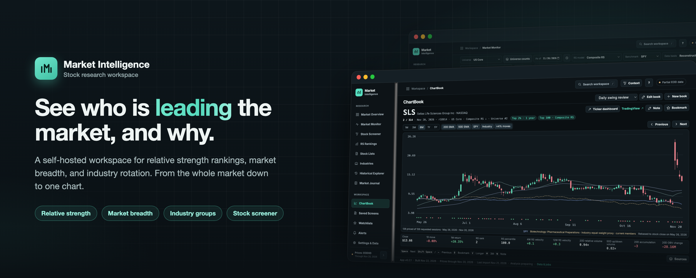
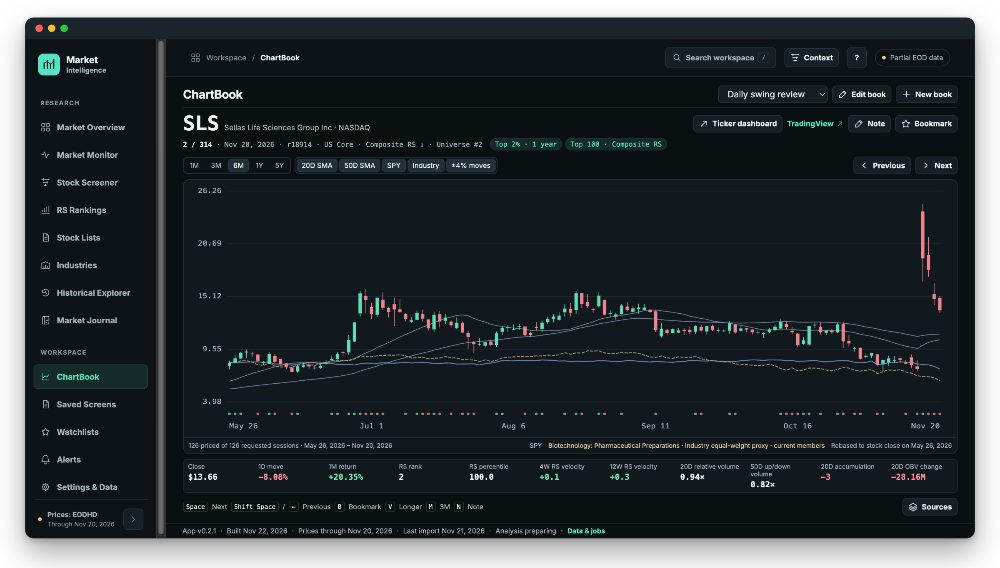
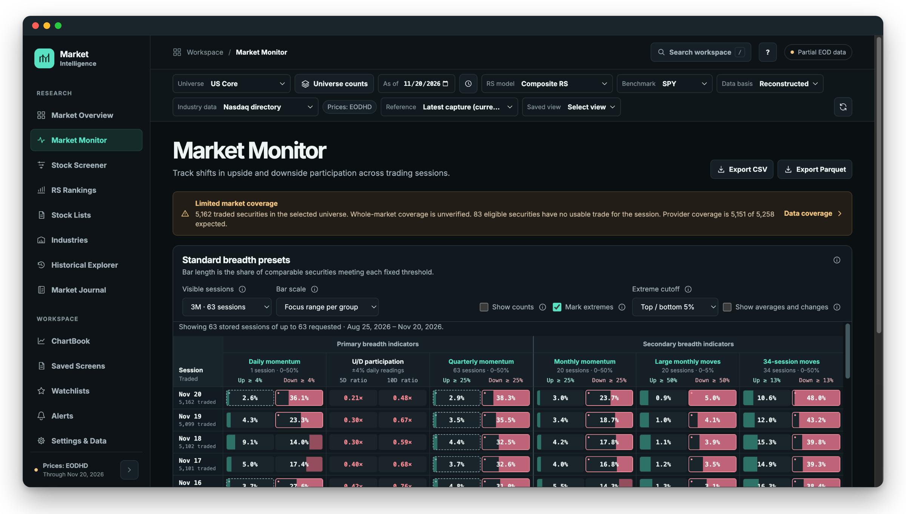
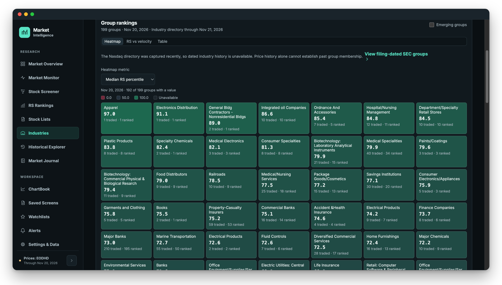
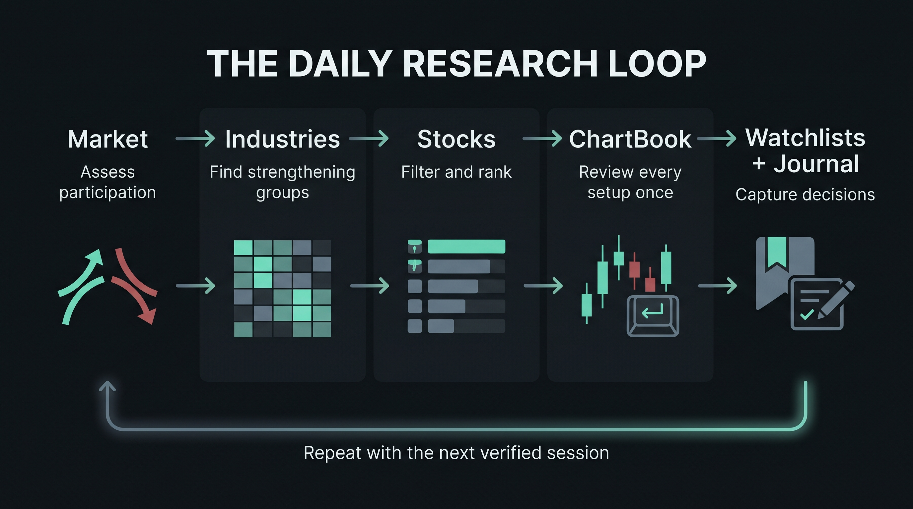
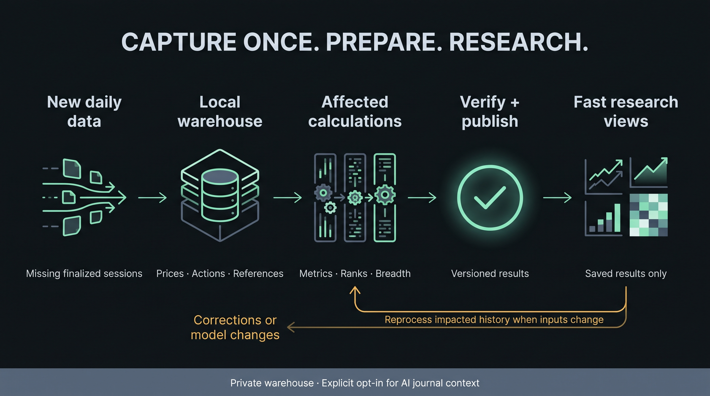

<div align="center">



# Market Intelligence

### Open-source, self-hosted stock research for relative strength, market breadth, and industry leadership

Start with the whole U.S. market. Find the industry groups that lead it. Find the stocks that drive those groups.<br>
Then review every chart once and keep a dated record of what you saw.

[](package.json)
[](#-requirements)
[](docs/ARCHITECTURE.md)
[](#-privacy-and-security)
[](#-project-status)
[](LICENSE)

**[Features](#-features)** &nbsp;·&nbsp; **[Screenshots](#-screenshots)** &nbsp;·&nbsp; **[Quick start](#-quick-start)** &nbsp;·&nbsp; **[How it works](#-how-it-works)** &nbsp;·&nbsp; **[Docs](#-documentation)** &nbsp;·&nbsp; **[FAQ](#-faq)**

</div>

<br>

## 🧭 At a glance

| | |
| :--- | :--- |
| **What it is** | A local research workspace for U.S. stocks. It ranks relative strength, measures market breadth, and tracks industry group rotation. |
| **Who it is for** | Swing and position traders, momentum and CAN SLIM-style researchers, and anyone who studies market leadership. |
| **What you get** | 13 app pages: breadth, RS rankings, industry heatmaps, a screener, ChartBook review, watchlists, alerts, history, and a journal. |
| **Where it runs** | On your own computer. Node.js server, browser UI, SQLite warehouse. |
| **Data** | End-of-day prices from EODHD (your own key), SEC/SIC and Nasdaq industry references. |
| **What it is not** | Not a broker, not a trading bot, not investment advice. |

<details>
<summary><b>📑 Table of contents</b></summary>

<br>

| Getting started | Using the app | Under the hood | Reference |
| :--- | :--- | :--- | :--- |
| [At a glance](#-at-a-glance) | [App pages](#-app-pages) | [How it works](#-how-it-works) | [Project status](#-project-status) |
| [Why use it](#-why-use-it) | [Key metrics](#-key-metrics) | [Tech stack](#-tech-stack) | [Documentation](#-documentation) |
| [Features](#-features) | [Research workflow](#-the-research-workflow) | [Project layout](#-project-layout) | [FAQ](#-faq) |
| [Screenshots](#-screenshots) | [Keyboard shortcuts](#%EF%B8%8F-keyboard-shortcuts) | [Data sources and limits](#-data-sources-and-limits) | [Disclaimer](#%EF%B8%8F-disclaimer) |
| [Quick start](#-quick-start) | [Everyday commands](#-everyday-commands) | [Privacy and security](#-privacy-and-security) | |
| [Configuration](#%EF%B8%8F-configuration) | | [Development](#-development) | [License](#-license) |

</details>

---

## 💡 Why use it

Most tools show you one piece: a chart, a screener, or an index. Market Intelligence puts the full top-down process in one place and keeps it honest.

| Problem | How Market Intelligence handles it |
| :--- | :--- |
| An index can rise while most stocks fall. | **Breadth first.** See how many stocks take part in a move before you look at any single name. |
| Strong stocks cluster in strong groups. | **Industry ranks.** Rank every group by median RS and see which ones are gaining strength. |
| "Strong" and "getting stronger" are different. | **RS rank and RS velocity** are shown side by side, so you can spot improving names early. |
| Watchlists overlap and charts get skipped. | **ChartBook** merges lists, removes duplicates, and walks every chart with the keyboard. |
| Old results change when data changes. | **Versioned data.** Every number is pinned to a data revision, universe, and calculation version. |
| Missing data quietly becomes zero. | **No silent gaps.** Missing values stay blank with a reason, and coverage warnings are shown on screen. |

## ✨ Features

<table>
<tr>
<td width="50%" valign="top">

#### 📊 Market breadth
- **Market Overview** with index context, breadth counts, and market-health parts
- **Market Monitor** with daily, monthly, and quarterly momentum readings
- Fixed and custom move thresholds (for example, up or down 4% in a day)
- 5-day and 10-day up/down participation ratios
- Drill down to the exact stocks that qualified on any date
- Labeled NYSE summation proxy (common-stock RASI)

</td>
<td width="50%" valign="top">

#### 🚀 Relative strength
- Return leader lists for **1W, 1M, 3M, 6M, and 1Y**
- Model-based **RS rankings** and **RS percentiles**
- **RS velocity** over 4 and 12 weeks
- Leadership persistence and changes over time
- Configurable top-percent cuts in Stock Lists
- Choice of universe, model, and benchmark

</td>
</tr>
<tr>
<td width="50%" valign="top">

#### 🏭 Industry groups and themes
- **Heatmap**, **RS vs velocity**, and **table** views
- Median RS percentile and participation per group
- Current-member 4W/12W RS backcast when dated Nasdaq velocity is unavailable
- Filing-dated **SEC/SIC** groups
- Current **Nasdaq directory** groups
- Rotation, breadth, and emerging-group views

</td>
<td width="50%" valign="top">

#### 🔎 Stock screener
- Nested conditions and multi-column sort
- Computed columns and supported expressions
- High/low, volume, accumulation, and risk measures
- History-aware fields that stay blank when data is missing
- **Saved Screens** you can rerun on any date

</td>
</tr>
<tr>
<td width="50%" valign="top">

#### 📈 ChartBook and notes
- Merge saved lists into one deduplicated review
- Open an industry's pinned stock list, preview 3M candles, and click through to full ticker stats
- Candles with 20D and 50D SMA, SPY, and industry lines
- ±4% move markers and a metrics strip under each chart
- Dated notes for a stock or a market/industry chart
- One-key bookmark into your default watchlist

</td>
<td width="50%" valign="top">

#### 🕰️ History, alerts, and operations
- **Historical replay** at a pinned data revision
- Cohorts, event studies, analogs, and forward returns
- **Alerts** on breadth, stock conditions, screens, groups, and regimes
- Resumable background jobs and SQLite backups
- **CSV and Parquet** exports

</td>
</tr>
</table>

## 📸 Screenshots

<p align="center">
  
  <br>
  <sub><b>ChartBook</b> &nbsp;·&nbsp; Review every name in your saved lists once, with RS rank, velocity, volume, and notes beside the chart.</sub>
</p>

<br>

<table>
<tr>
<td width="50%" align="center" valign="top">
  
  <br>
  <sub><b>Market Monitor</b> &nbsp;·&nbsp; Upside and downside participation across 63 sessions, with extremes marked.</sub>
</td>
<td width="50%" align="center" valign="top">
  
  <br>
  <sub><b>Industry heatmap</b> &nbsp;·&nbsp; Rank industry groups by median RS percentile to spot rotation.</sub>
</td>
</tr>
</table>

<p align="center"><sub>Unedited captures of app build R11 / 0.2.1, Nov 21, 2026. Values show that date's data and coverage. Source details: <a href="docs/README-ASSETS.md">asset register</a>.</sub></p>

## 🗂️ App pages

| | Page | What you see | Use it to answer |
| :---: | :--- | :--- | :--- |
| 🌐 | **Market Overview** | Index context, breadth counts, leadership, market health, Session Review | *What does the selected rule profile observe this session?* |
| 📉 | **Market Monitor** | Momentum and participation readings by session | *Is this move broad or narrow?* |
| 🔎 | **Stock Screener** | Nested filters, sorts, computed columns | *Which stocks match my rules today?* |
| 🏆 | **RS Rankings** | Model-based ranks, percentiles, and velocity | *Which stocks are strongest, and which are improving?* |
| 📋 | **Stock Lists** | Return leaders for 1W to 1Y | *What led over this period?* |
| 🏭 | **Industries** | Group heatmap, RS vs velocity, table | *Which groups lead, and which are rotating in?* |
| 🕰️ | **Historical Explorer** | Replay, cohorts, events, forward returns | *What happened after similar setups?* |
| 📓 | **Market Journal** | Dated market notes, optional Claude drafts | *What did I see, and when?* |
| 📈 | **ChartBook** | Keyboard chart review across saved lists | *Did I look at every candidate?* |
| 💾 | **Saved Screens** | Reusable screen definitions | *Can I rerun last week's screen?* |
| ⭐ | **Watchlists** | Manual lists or live screen members | *What am I tracking?* |
| 🔔 | **Alerts** | Rules on breadth, stocks, screens, groups, regimes | *Tell me when something changes.* |
| ⚙️ | **Settings & Data** | Sources, jobs, readiness, quality, backups | *Is the data ready to trust?* |

## 📐 Key metrics

| Metric | Plain meaning | Where you see it |
| :--- | :--- | :--- |
| **RS rank** | A stock's position in its comparable group, by the selected RS model | RS Rankings, ChartBook |
| **RS percentile** | The same rank on a 0 to 100 scale (100 is strongest) | RS Rankings, Industries |
| **RS velocity** | Change in RS percentile over 4 or 12 weeks | RS Rankings, ChartBook |
| **Return leaders** | Top stocks by raw return over 1W, 1M, 3M, 6M, or 1Y | Stock Lists |
| **Daily momentum** | Share of stocks up or down 4% or more in one session | Market Monitor |
| **Monthly / quarterly momentum** | Share of stocks up or down 25% over 20 or 63 sessions | Market Monitor |
| **U/D participation ratio** | Up moves vs down moves over 5 or 10 sessions | Market Monitor |
| **Median group RS** | The middle RS percentile of a group's ranked members | Industries |
| **Relative volume** | Recent volume compared with its 20-day average | ChartBook, Screener |
| **Summation proxy** | A common-stock RASI line, labeled as a proxy for NYSI | Market Overview |

> [!NOTE]
> RS rank answers *"how strong is it now?"* RS velocity answers *"is it getting stronger?"* They are different questions, so the app shows both.

## 🔁 The research workflow

<p align="center">
  
</p>

| Step | Do this | Pages |
| :---: | :--- | :--- |
| **1** | **Read the market.** Check how many stocks take part, not only what the index did. | Market Overview, Market Monitor |
| **2** | **Find leading groups.** Look for groups that are strong and gaining strength. | Industries |
| **3** | **Screen and rank stocks.** Find names with strong and improving RS. | RS Rankings, Stock Lists, Screener |
| **4** | **Review each chart once.** Walk the merged list with the keyboard. | ChartBook |
| **5** | **Keep a dated record.** Save the screen, bookmark names, write notes. | Saved Screens, Watchlists, Journal |

## ⌨️ Keyboard shortcuts

ChartBook is built for fast review with the keyboard.

| Key | Action |
| :---: | :--- |
| <kbd>Space</kbd> | Next stock |
| <kbd>Shift</kbd> + <kbd>Space</kbd> or <kbd>←</kbd> | Previous stock |
| <kbd>B</kbd> | Bookmark to your default watchlist |
| <kbd>V</kbd> | Longer chart range |
| <kbd>M</kbd> | Set chart to 3 months |
| <kbd>N</kbd> | Open the dated note |
| <kbd>↑</kbd> <kbd>↓</kbd> / <kbd>Home</kbd> <kbd>End</kbd> | Step through sessions on a focused chart |
| <kbd>Esc</kbd> | Close the point display or note editor |
| <kbd>/</kbd> | Search the workspace |

Shortcuts turn off while you type in a field or a dialog is open. Full guide: [ChartBook](docs/CHARTBOOK.md).

## 🚀 Quick start

### ✅ Requirements

| Need | Version / notes |
| :--- | :--- |
| **Node.js** | 26 LTS recommended and tested. Supported: `^24.15.0` or `>=26.0.0` |
| **npm** | Comes with Node.js |
| **OS** | macOS is tested, including the managed background service |
| **Price data** | Your own [EODHD](https://eodhd.com) API key (optional for the UI, needed to download prices) |
| **DuckDB CLI** | Optional, only for Parquet export |

### 📦 Install and run

```sh
git clone https://github.com/joshuamschultz/market-intelligence.git
cd market-intelligence
npm ci
npm run app -- start --workspace
```

The app opens in your browser at `http://127.0.0.1:4173`.

> [!TIP]
> A fresh clone has **no market data**. The `data/` warehouse is private and not in Git. Add an EODHD key and run an update to start capturing prices.

> [!IMPORTANT]
> Do not run two server processes against the same database (`MARKET_DB`). To run in the foreground, first stop the managed service with `npm run app -- stop`, then use `npm start` or `npm run dev`.

On macOS you can run the app as a managed background service. See the [Desktop quickstart](docs/LOCAL-QUICKSTART.md).

## ⚙️ Configuration

Copy `.env.example` to `.env` and set what you need. Keep `.env` private.

| Variable | Default | What it does |
| :--- | :--- | :--- |
| `EODHD_API_KEY` | *(empty)* | Your price provider key. Read on the server only. |
| `HOST` | `127.0.0.1` | Address the server listens on. Loopback keeps it on your computer. |
| `PORT` | `4173` | Port for the web app. |
| `MARKET_DB` | `data/market.sqlite` | Path to the SQLite warehouse. |
| `MARKET_ACCESS_TOKEN` | *(empty)* | Workspace login token. Required (20+ characters) for a non-loopback `HOST`. |
| `MARKET_SYNC` | `0` | Set to `1` for scheduled daily price imports. |
| `MARKET_SYNC_AFTER` | `16:30` | Time (America/New_York) the daily import runs. |
| `MARKET_PRECOMPUTE` | `0` | Set to `1` to run calculations after each import. |
| `MARKET_REFERENCE_SYNC` | `0` | Set to `1` to refresh reference data on a schedule. |
| `MARKET_NASDAQ_SYNC` | `0` | Set to `1` to refresh the Nasdaq industry directory. |
| `MARKET_BACKUP` | `0` | Set to `1` for automatic SQLite backups. |
| `MARKET_BACKUP_RETAIN` | `1` | Number of backups to keep. |
| `MARKET_DUCKDB_BIN` | `duckdb` | Path to the DuckDB CLI for Parquet export. |

## 🛠️ Everyday commands

| Task | Command | What it does |
| :--- | :--- | :--- |
| ▶️ Start and open | `npm run app -- start` | Reuses the managed service. On a fresh clone, add `--workspace`. |
| 📋 Check status | `npm run app -- status` | Build, source, and readiness. Daily data and full analysis are shown apart. |
| ⏹️ Stop | `npm run app -- stop` | Stops the server. Data stays on disk. |
| 🔄 Update daily data | `npm run update -- --wait` | Imports missing finalized sessions and waits for the daily job. |
| ⏳ Wait for analysis | `npm run update -- --wait-analysis` | Waits until the current session's full analysis is ready. |
| 🏢 Refresh Nasdaq groups | `npm run refresh:nasdaq` | Captures the current Nasdaq industry directory. |
| 💻 Foreground server | `npm start` / `npm run dev` | Runs the server in the terminal (`dev` reloads on change). |
| ✅ Validate | `npm run check` | Runs the project checks. |
| 🧪 Test | `npm test` | Runs the Node test suite. |

## 🏗️ How it works

<p align="center">
  
</p>

| Stage | What happens | Why it matters |
| :--- | :--- | :--- |
| **1. Capture** | Provider downloads are saved with manifests and checked before import. Daily updates fetch only missing finalized sessions. | No full re-download every day. |
| **2. Store** | A SQLite (WAL) warehouse keeps prices, corporate actions, references, and every source revision. | You can trace any number back to its source. |
| **3. Calculate** | A shared engine computes metrics, ranks, breadth, and health for exact contexts: universe, model, benchmark, classification, date, and price basis. | Same inputs always give the same result. |
| **4. Verify and publish** | Results ship as versioned, immutable builds. Corrections or model changes need an explicit, verified backfill. | Old results do not change by surprise. |
| **5. Research** | The browser reads prepared results instead of recomputing on each request. | Pages load fast. |

> [!WARNING]
> A finished price download does not mean breadth, ranks, and studies are ready for that session. Check readiness for the exact context before you read a chart or list.

## 🧱 Tech stack

| Layer | Technology |
| :--- | :--- |
| **Server** | Node.js (ES modules), built-in HTTP server, background job worker |
| **Storage** | SQLite in WAL mode, versioned revisions, backups |
| **Frontend** | Plain JavaScript, HTML, and CSS, no build step |
| **Exports** | CSV, Parquet via DuckDB CLI |
| **Tests** | Node built-in test runner, jsdom for UI tests |
| **AI (optional)** | Anthropic Claude for Market Journal drafts; scoped read-only research API and MCP |

## 📁 Project layout

| Path | Contents |
| :--- | :--- |
| `backend/` | Server, calculation engine, breadth, ranking, screener, jobs, storage |
| `frontend/` | Browser app pages, charts, ChartBook, help content, styles |
| `scripts/` | Workspace CLI, ingest, release, backup, verification tools |
| `tests/` | Node test suite |
| `docs/` | Guides, architecture, operations, benchmarks, README assets |
| `data/` | Your private warehouse, captures, logs, backups (ignored by Git) |

## 🧾 Data sources and limits

| Source | Used for | Notes |
| :--- | :--- | :--- |
| **EODHD** | End-of-day prices, bulk history, splits, delisted listings | Needs your own API key |
| **SEC / SIC** | Filing-dated industry classifications | Linked to the current catalog |
| **Nasdaq directory** | Current industry reference | A current snapshot, not a history |

| Known limit | What it means for you |
| :--- | :--- |
| Broad capture starts Nov 2016 | 2015 to 2016 holds only a small sample. |
| Historical membership | Full survivorship-free membership is not yet established. |
| Public float | Not available. The app does not guess it from shares outstanding. |
| Delistings and ticker reuse | Terminal returns and identity history need more source evidence. |
| Health scores | Describe available inputs. They are not forecasts. |
| Summation line | A labeled common-stock RASI proxy, not the published NYSI. |

## 🔒 Privacy and security

- 🏠 **Local by default.** The server binds to `127.0.0.1`. The warehouse, captures, logs, and backups stay in `data/`, which Git ignores.
- 🔑 **Keys stay on the server.** Provider keys are never sent to the browser.
- 🤖 **AI is opt-in.** Market Journal drafts send selected context to Anthropic when requested; private notes require a separate opt-in. External research clients receive only results allowed by their scoped token, and their prompt/tool results are sent to the provider you choose.
- 🧩 **Research API and MCP** provide scoped, read-only access to prepared data. External clients receive the tool results you request; provider accounts are not connected by default. See [AI connections](docs/AI-CONNECTIONS.md) and [AI research contract](docs/AI-RESEARCH-CONTRACT.md).

## 🧑‍💻 Development

```sh
npm ci
npm run check
npm test
```

- Tests use the built-in Node test runner (`node --test`).
- The release builder promotes a build only after a fresh, complete test run, and records the results as release evidence.
- Benchmark records and their scope live in [`docs/benchmarks`](docs/benchmarks/2026-11-22-daily-append.json).
- Read [Operations](docs/OPERATIONS.md) before you import, restore, or archive data.

## 📍 Project status

Source package version: **0.3.2**. Use `/api/v1/build` or `data/active-release.json` to confirm which build is active.

| Area | Status | Notes |
| :--- | :---: | :--- |
| Five-year history (1,260 sessions) | ✅ | Published |
| NYSE summation sessions | ✅ | Published |
| SEC industry groups (68) with velocity | ✅ | Ready |
| Daily ordered catch-up | 🟡 | Tested on synthetic data; no live provider day observed yet |
| Cold five-year rebuild speed | 🟡 | 72.6 minutes vs a 10-minute target |
| Research API and MCP server | 🟡 | Implemented and tested in source; no external client/provider account has been connected |
| Docker deployment | ⚪ | Config present, not verified |

Open items: [Remaining work](docs/REMAINING-WORK.md) · [Performance acceptance](docs/PERFORMANCE-ACCEPTANCE.md)

## 📚 Documentation

| Guide | Covers |
| :--- | :--- |
| 🖥️ [Desktop quickstart](docs/LOCAL-QUICKSTART.md) | Install and run the managed macOS service |
| 🔧 [Operations](docs/OPERATIONS.md) | Import, backup, restore, and recovery |
| 🏗️ [Architecture](docs/ARCHITECTURE.md) | Data flow and system design |
| 🧭 [AI connections](docs/AI-CONNECTIONS.md) | Scoped API/MCP access and provider-specific connection limits |
| 🤖 [AI research contract](docs/AI-RESEARCH-CONTRACT.md) | Tool catalog, provenance, pagination, and statistical interpretation |
| 🏭 [Industry velocity](docs/INDUSTRY-VELOCITY.md) | Dated and current-member group RS comparisons, coverage, and limits |
| 📊 [Session Review](docs/SESSION-REVIEW.md) | Rule profile, trend and breadth definitions, data limits |
| 📈 [ChartBook guide](docs/CHARTBOOK.md) | Chart review, shortcuts, and notes |
| 📋 [Requirements](docs/REQUIREMENTS.md) | Requirements and implementation status |
| ⏱️ [Performance acceptance](docs/PERFORMANCE-ACCEPTANCE.md) | Targets and measured results |
| ✅ [Remaining work](docs/REMAINING-WORK.md) | Open items checklist |

## ❓ FAQ

<details>
<summary><b>What is relative strength (RS) in stock analysis?</b></summary>
<br>

Relative strength compares a stock's price performance with other stocks or a benchmark over a period. Market Intelligence ranks each stock within a comparable population and shows its RS percentile. **RS velocity** is the change in that percentile over 4 or 12 weeks, so you can see which names are improving, not only which are already strong.

</details>

<details>
<summary><b>What is market breadth and why does it matter?</b></summary>
<br>

Market breadth measures how many stocks take part in a market move. An index can rise while most stocks fall. The Market Monitor counts the share of stocks past fixed move thresholds over 1, 20, 34, and 63 sessions, plus up/down ratios, so you can see if a rally or sell-off is broad or narrow.

</details>

<details>
<summary><b>How do I find leading industry groups and sector rotation?</b></summary>
<br>

Open **Industries**. The heatmap ranks every group by median RS percentile. The RS-vs-velocity view shows groups that are strong and getting stronger, which is often where rotation shows up first.

</details>

<details>
<summary><b>Can I use it for CAN SLIM or momentum trading research?</b></summary>
<br>

Yes, as a research tool. It gives you the parts those methods use: market direction through breadth, leading industry groups, RS ranks, and volume measures. It does not score stocks against any one named method and does not place trades.

</details>

<details>
<summary><b>Is this a replacement for a charting platform or broker?</b></summary>
<br>

No. It is a research and review workspace. It links to TradingView for full charting and does not place trades.

</details>

<details>
<summary><b>Does my data leave my computer?</b></summary>
<br>

The app is local-first, but external AI calls send the prompt and selected tool results to that provider. A scoped research token can read only its authorized prepared data; notes and Market Journal records require their own opt-in scopes. The separate Market Journal generation feature sends selected context to Anthropic when requested; personal notes are included only with a separate opt-in. External provider accounts are not connected by default.

</details>

<details>
<summary><b>Which data provider do I need?</b></summary>
<br>

The capture pipeline uses **EODHD** for end-of-day prices, history, and corporate actions. You need your own API key.

</details>

## 📜 License

Market Intelligence is open source under the [MIT License](LICENSE).

| You may | You must |
| :--- | :--- |
| ✅ Use it for any purpose, including commercial use | 📌 Keep the copyright notice and license text in every copy |
| ✅ Change it and share your changes | |
| ✅ Include it in your own projects | |

Copyright (c) 2026 [Josh Schultz](https://github.com/joshuamschultz). The software comes as is, with no warranty.

## ⚖️ Disclaimer

> [!CAUTION]
> Market Intelligence is a research tool. It is **not investment advice**, and nothing in it is a recommendation to buy or sell any security. Market data can be incomplete, late, or wrong. Check the coverage and readiness views before you rely on any result.

---

<div align="center">
<sub>Market Intelligence · relative strength rankings · market breadth · industry group rotation · sector rotation · stock screener · self-hosted stock research · open source</sub>
</div>
